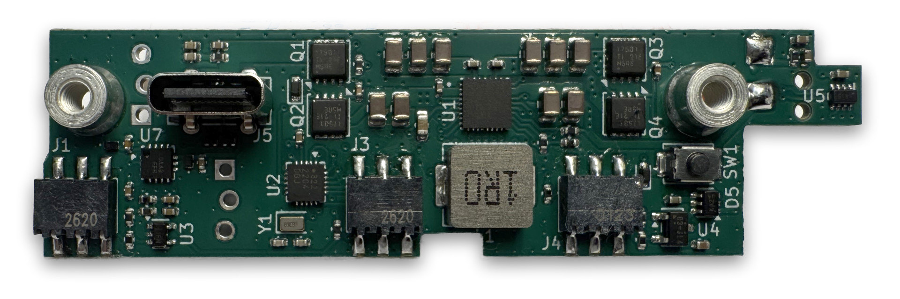
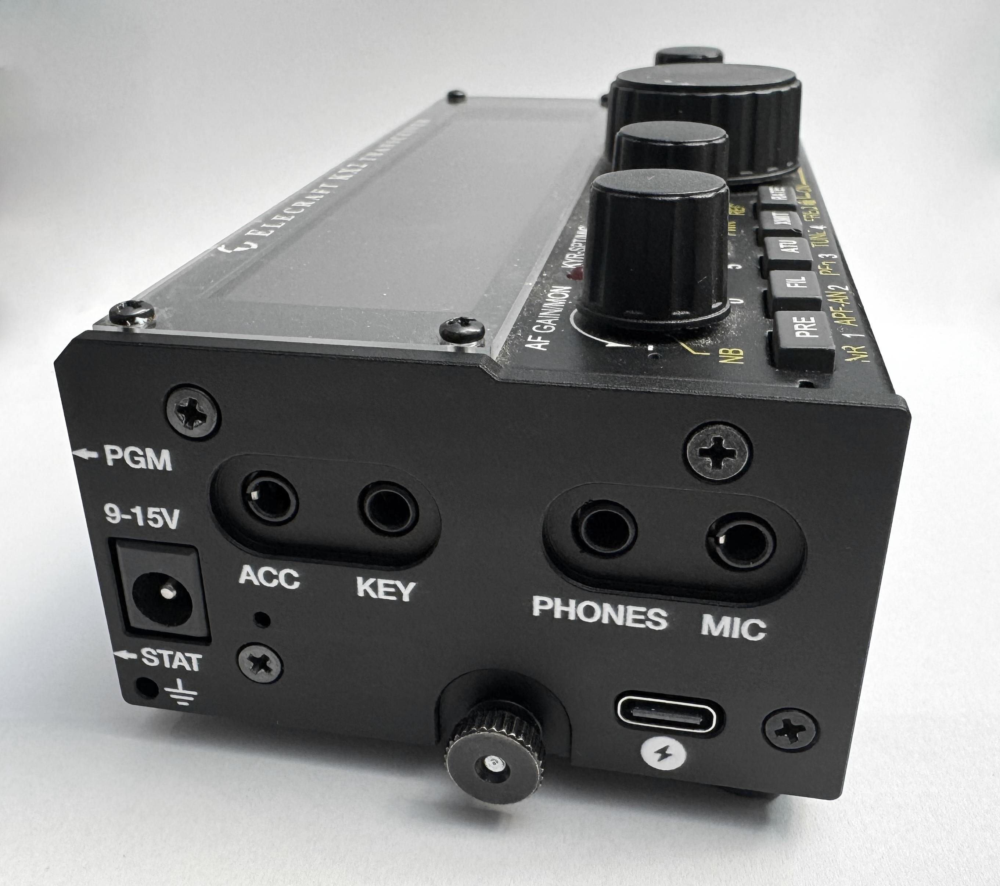

# KXUSBC2 – Internal USB-C charger for the Elecraft KX2

The KXUSBC2 is an unofficial internal option for the Elecraft KX2 that adds a bidirectional USB-C port for charging the battery and powering external devices.

## Features

* Charge the internal battery or power an external device over USB-C at up to 30 W.
* Charge from USB-C or the KX2's DC jack, with support for USB PD 3.0, QC and BC1.2.
* Charging is suspended by default while the KX2 is on to avoid QRM.
* Includes an RTC, RGB status LED, configuration button and battery voltage monitoring.
* Supports optional battery temperature monitoring.

## Documentation

Visit the [KXUSBC2 documentation](https://manuelkasper.github.io/kxusbc2/docs/) for the [installation guide](https://manuelkasper.github.io/kxusbc2/docs/installation/), [user guide](https://manuelkasper.github.io/kxusbc2/docs/user_guide/) and [technical notes](https://manuelkasper.github.io/kxusbc2/docs/technical_notes/).

* [Where to buy](https://manuelkasper.github.io/kxusbc2/docs/#where-to-buy)
* [Web-based firmware programmer](https://manuelkasper.github.io/kxusbc2/programmer/)
* [License](https://manuelkasper.github.io/kxusbc2/docs/licence/) and [disclaimer](https://manuelkasper.github.io/kxusbc2/docs/disclaimer/)

The KXUSBC2 is not affiliated with or endorsed by Elecraft. Use it at your own risk.

